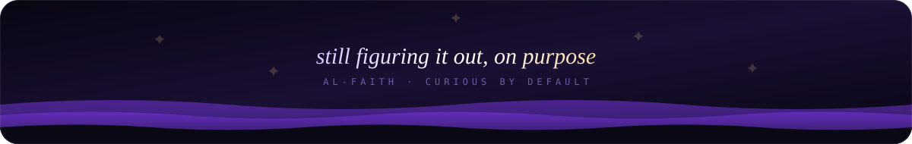

<div align="center">



<a href="https://github.com/Al-Faith"></a>

<br/>

<a href="https://x.com/Adfiels"></a>


</div>


### &nbsp;✦ who's this

I don't have one lane. Something catches my eye, I poke at it until it makes sense, then I move on to whatever catches my eye next.

Right now that's **Flutter / Dart**, dipping into **Python for AI tooling**, and **MySQL** whenever data needs a home. Ask me again in a month, it'll probably be different.

```dart
class AlFaith extends Curious {
  final stack  = ['Flutter', 'Dart', 'Python', 'MySQL'];
  final status = 'figuring it out, on purpose';

  @override
  void live() {
    while (true) {
      final spark = findSomethingInteresting();
      spark.breakApart().rebuild();
      keepOrDiscard(spark);   // no guilt either way
    }
  }
}
```


### &nbsp;✦ right now

| &nbsp; | focus | what's going on |
|:--:|:--|:--|
| ◆ | **Flutter / Dart** | building interfaces that feel alive |
| ◆ | **Python + AI tooling** | small tools, prompt experiments, lots of poking |
| ◆ | **MySQL** | giving data a proper home |
| ◇ | **next** | ask me in a month |


### &nbsp;✦ the loop

<div align="center">

</div>


### &nbsp;✦ stack, loosely

<div align="center">

<br/><br/>

</div>

<details>
<summary><b>notes to self</b> &nbsp;<sub>(click to open)</sub></summary>

<br/>

> curiosity first, roadmap second.
> ship the weird version before the safe one.
> delete without guilt, learn without limits.

</details>


### &nbsp;✦ the snake is hungry

<div align="center">

<picture>
  <source media="(prefers-color-scheme: dark)" srcset="https://raw.githubusercontent.com/Al-Faith/Al-Faith/output/snake-dark.svg" />
  <source media="(prefers-color-scheme: light)" srcset="https://raw.githubusercontent.com/Al-Faith/Al-Faith/output/snake.svg" />
  
</picture>

</div>


### &nbsp;✦ numbers, for the curious

<div align="center">


<br/>


<br/>


</div>

<!--
  pinned experiments (uncomment and swap in your repo names):

<div align="center">
  <a href="https://github.com/Al-Faith/REPO_ONE"></a>
  <a href="https://github.com/Al-Faith/REPO_TWO"></a>
</div>
-->

<br/>


